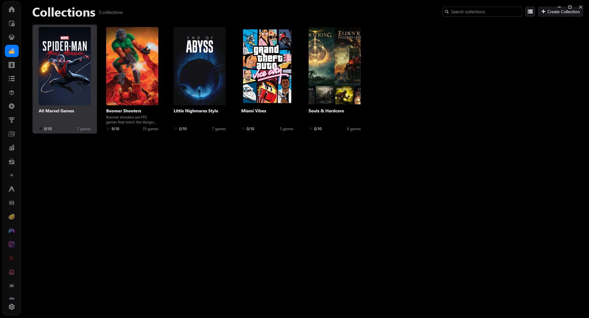
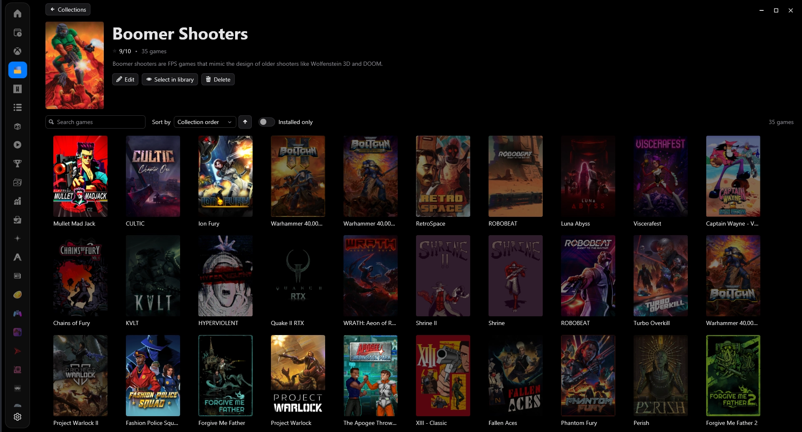
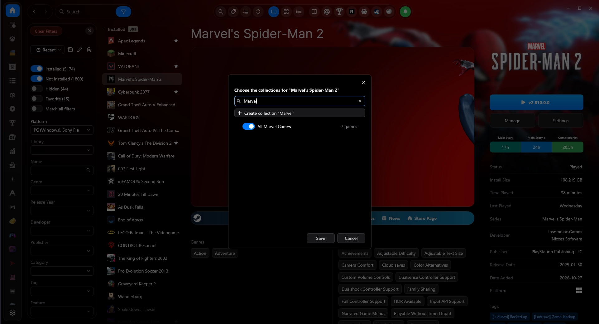

<p align="center">
  
</p>

<h1 align="center">Game Collections for Playnite</h1>

<p align="center">
  Group your <a href="https://playnite.link">Playnite</a> games into custom collections with a poster, description and rating.
</p>

<p align="center">
  <a href="LICENSE"></a>
  
  
</p>



## Features

- **Add to Collection…** in every game's right-click menu, for one game or many. Search your collections,
  tick or untick them, or type a new name and press Enter to create one on the spot.
- **Collections** in the sidebar: every collection in a grid or a list (your choice is remembered), with search
  and create, edit and delete.
- **Collection pages** show the poster, description, rating and games. You can search, sort by name, release date,
  last played, time played or date added, group them by platform, genre, series and more, show installed games
  only, and Play/Install, Show in library or Remove games. Collapse the header or groups, and resize the game cards.
- **Manual order**: drag games into the order you want, or use the right-click menu or Alt+arrow keys.
- **Dynamic collections** fill themselves from your rules, for example *Platform is PS1 and Genres include Indie*.
  Combine conditions into blocks, join blocks with AND or OR, and see the matching games live while you edit.
- **Game details integration**: see the selected game's collections in the details view, with any theme that
  keeps Playnite's standard layout. Themes can also choose where the list goes.
- **Posters**: use your own image, or let the collection use its first game's cover.
- **Safe with your library and data**:
  - Deleting a collection never touches its games.
  - Games removed from Playnite are dropped from collections automatically.
  - Saves are atomic and keep a backup.
- Works with light and dark themes, because it uses Playnite's theme styles throughout.

| Collection page | Add to Collection |
|---|---|
|  |  |

## Installation

- **From Playnite**: once it's listed, use *Add-ons → Browse → Generic* and search for "Game Collections".
- **Manually**: download the `.pext` file from the [latest release](https://github.com/X4Lo/GameCollections/releases/latest)
  and open it. Playnite installs it and asks to restart.

Requires a recent Playnite 10 release (extension SDK 6.11 or later), in Desktop mode.

## Documentation

- [User guide](docs/user-guide.md): how to use every feature, keyboard shortcuts, where data is stored, and known limitations.
- [Architecture and development](docs/architecture.md): repository layout, building, and how the code is organized.
- [Developer guide](docs/developer-guide.md): how it works in depth, the data format, adding rule fields, testing and releasing.
- [Changelog](CHANGELOG.md)

## Theme Integration

Theme authors can choose where the collections list appears and bind to the extension's settings.
See [Theme integration](docs/theme-integration.md).

## Translations

Translations are managed on [Crowdin](https://crowdin.com/project/game-collections). Anyone can join the project
and translate the extension into their language, with no coding needed. New translations are added to the
extension in its next release, and any string that isn't translated yet is shown in English.

To request a language that isn't listed, open an issue.

## Contributing

Bug reports, feature ideas, translations and pull requests are welcome. See [CONTRIBUTING.md](CONTRIBUTING.md).

## Building

```
dotnet build source/GameCollections.sln -c Release
```

The installable package is written to `dist/`. See [docs/architecture.md](docs/architecture.md) for details.

## Credits

Developed by X4Lo with the help of **Claude Opus 5.5** (Anthropic), which wrote the code and documentation
from X4Lo's specification.

## License

[MIT](LICENSE)
